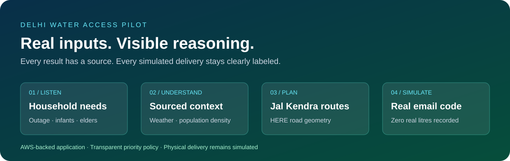
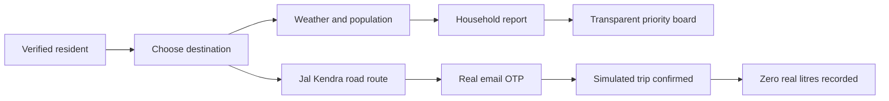
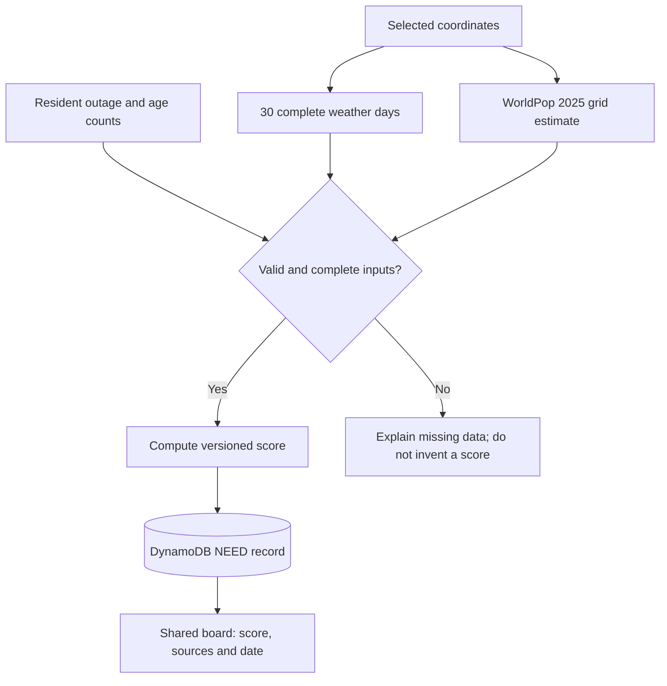
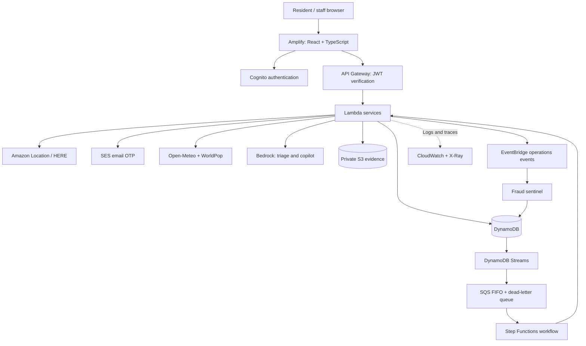
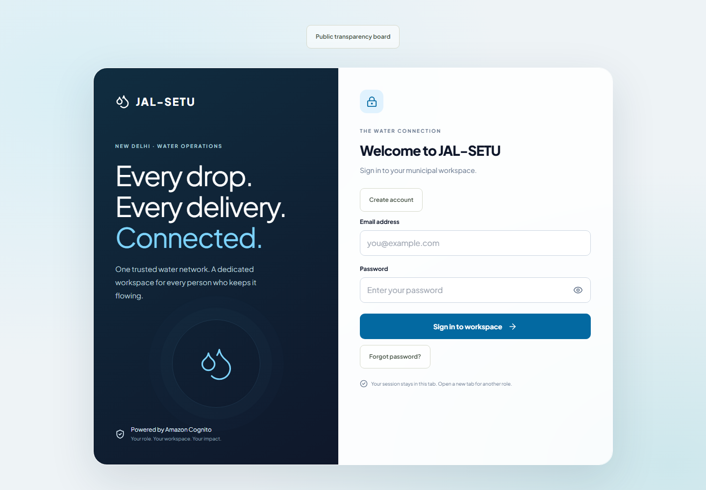
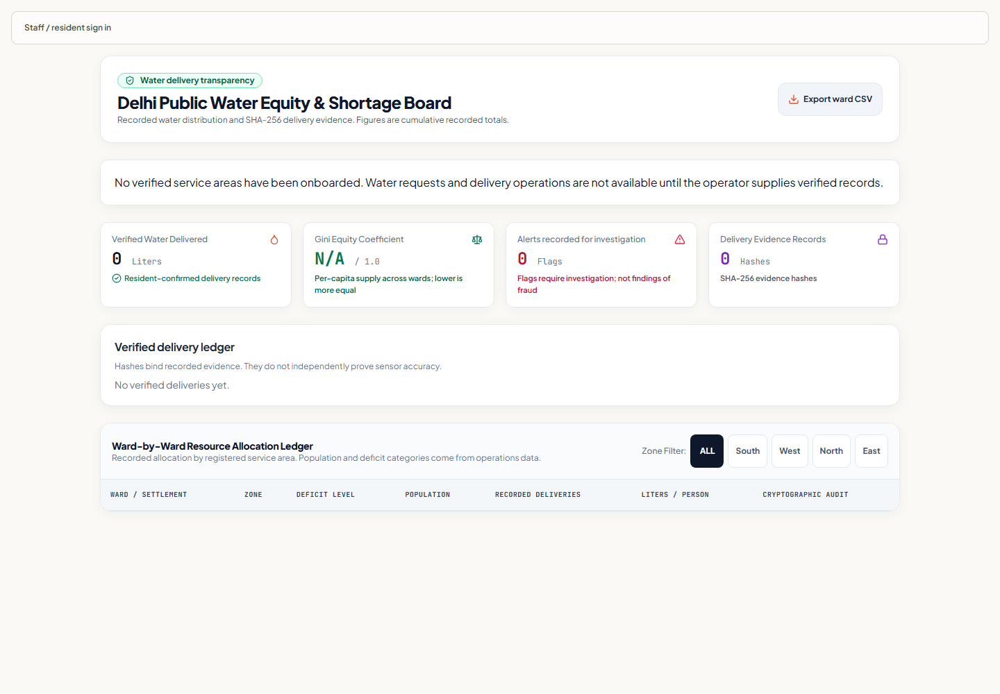

<div align="center">

# JAL-SETU · जल–सेतु

### Understand water needs. Prioritize transparently. Plan the road ahead.

**A Delhi water-access pilot with real routing, sourced data, and clearly simulated delivery.**

[Open live pilot](https://main.deemkw95tpvmo.amplifyapp.com) · [Explore the code](https://github.com/mysterio-Apoorva/JalSetu) · [Deployment guide](docs/PILOT_DEPLOYMENT.txt) · [AWS setup](docs/AWS_SETUP.md)



</div>

JalSetu connects a resident's reported water need to local weather, population density and a road route from a Jal Kendra. It makes the source and limits of each result visible. A simulated trip can be confirmed by email without creating a claim that water was physically delivered.

> **Pilot boundary:** this is an independently developed project, not an official Delhi Jal Board booking service. Household reporting does not reserve a tanker. Physical delivery, fleet availability and official allocation remain outside the active pilot.

## Explore

| Use the product | Understand the system | Run and maintain it |
| --- | --- | --- |
| [Resident journey](#resident-journey) | [Architecture](#architecture) | [Local development](#local-development) |
| [What is real?](#what-is-real) | [Priority calculation](#priority-calculation) | [Verification](#verification) |
| [Jal Kendra locations](#jal-kendra-locations) | [Bedrock explained](#bedrock-explained) | [Release process](#release-process) |
| [Screenshots](#screenshots) | [AWS service map](#aws-service-map) | [Operational readiness](#operational-readiness) |

## Resident journey

1. Create an account, verify your email with Cognito and sign in.
2. Find a destination by address, click the map, or enter latitude and longitude.
3. Inspect recent weather and the WorldPop sampling area. Pending and unavailable data are shown explicitly.
4. Select an enabled Jal Kendra and calculate its fastest provider-estimated truck route to the destination.
5. Report outage days and household vulnerability counts to receive a reproducible priority score.
6. Where email sending is enabled, request a real code and confirm the **simulated** trip. Real delivered litres remain **zero**.



## What is real?

| Feature | Source or mechanism | What the result means |
| --- | --- | --- |
| Sign-in and verification | Amazon Cognito | Real accounts; public registration grants Citizen access only |
| Search and route geometry | Amazon Location / HERE | Actual provider results; server controls origin; no straight-line fallback |
| Map background | OpenStreetMap through Leaflet | Geographic context; separate from the routing provider |
| Weather | Open-Meteo | Recent model output with dates, not an on-site sensor reading |
| Population density | WorldPop Global 2, year 2025 | Modeled population within a displayed grid, not a live census |
| District comparison | Delhi Statistical Abstract, Census 2011 | Historical nine-district reference, not automatically assigned to a selected point |
| Household vulnerability | Resident-entered counts | Infants under 1 and elders aged 60+, not verified area-wide age statistics |
| Priority score | Versioned server-side formula | Policy-based ranking, not a trained prediction model |
| Trip confirmation OTP | Amazon SES | Real email when sender and applicable recipients are verified; sandbox restrictions apply |
| Tanker delivery scene | AI-generated illustration | Simulated scene, never delivery evidence |
| Physical delivery | Outside the active pilot | No invented tanker movements, deliveries or water totals |

## Jal Kendra locations

The [centre registry](backend/shared/jal-kendras.json) preserves the supplied map links. The API accepts a centre ID and resolves its coordinates on the server. Browser-supplied origin coordinates cannot change the starting point.

| Requested centre | Routing status | Location evidence |
| --- | --- | --- |
| Vasant Kunj tanker station | Enabled for planning | `G5G2+WJ6` resolves to `7JWVG5G2+WJ6`: **28.5272875, 77.151515625**; HERE independently lists a tanker station approximately 6 m away |
| Ujwa Filling Point | Exact pin needed | Supplied name search did not establish the filling point |
| Nangloi OHT | Exact pin needed | Several Jal Board offices returned; selecting one would be ambiguous |
| 194 Ashok Vihar Phase 1 | Exact pin needed | Address search did not establish the exact facility |

A resolved point establishes a planning origin, not opening hours, water availability, tanker capacity or dispatch permission. Plus Code recovery uses Google's [Open Location Code library](https://github.com/google/open-location-code).

**“Optimal” in this planner:** Amazon Location receives `TravelMode: Truck`, `OptimizeFor: FastestRoute`, departure now and a request for full road geometry. It returns the provider's fastest estimated route from the selected centre. This does not guarantee shortest distance, future travel time, or a globally optimal fleet schedule. Truck dimensions and operator-confirmed restrictions are not yet supplied.

## Priority calculation

The resident board uses [`pilot-priority-v2`](backend/shared/priority.js). Define `clamp(x) = min(1, max(0, x))`. Multiply each normalized factor by its weight, add the results, then round once to an integer from 0 to 100.

| Factor | Maximum points | Normalization | Source |
| --- | ---: | --- | --- |
| Water outage | 30 | `clamp(days / 14)` | Resident report |
| Dry spell | 15 | `clamp(dryDays / 30)` | Open-Meteo; a dry day has less than 1 mm rain |
| Heat | 10 | `clamp((temperature - 25) / 15)` | Mean temperature over 7 complete days, °C |
| Infants | 15 | `clamp(infants / 5)` | Reported household members under 1 |
| Elders | 20 | `clamp(elders / 5)` | Reported household members aged 60+ |
| Population density | 10 | `clamp(peoplePerKm2 / 30000)` | WorldPop 2025 estimate |
| **Total** | **100** | **Rounded sum** | **Calculated on the server** |

For illustration only: 7 outage days, 6 dry days, 32.5°C, 1 infant, 2 elders and 15,000 people/km² produce `15 + 3 + 5 + 3 + 8 + 5 = 39`. This is an arithmetic example, not a household record.



Weather excludes today's incomplete aggregate in the Asia/Kolkata calendar. Thirty uninterrupted dry days are shown as **30+**, because the observation window ends there. WorldPop uses a deterministic 0.02° grid cell; the provider returns its area in km². Reports fall off the active board after seven days. The shared board omits household age counts; stored reports still require appropriate access and retention handling.

These weights are pilot policy, not official drought criteria or a validated allocation model. Total population does **not** establish how many elderly residents live in a locality; that requires a separately sourced age-distribution dataset. Legacy version-1 reports retain their version label and lack the density component.

Sources: [Open-Meteo](https://open-meteo.com/en/docs), [WorldPop API](https://api.worldpop.org/v2/), [Delhi Statistical Abstract 2022, Table 12.8](https://des.delhi.gov.in/sites/default/files/DES/generic_multiple_files/sabstract2022.pdf). WorldPop estimates are attributed under CC BY 4.0. See [methodology](docs/REAL_DATA_AND_ROUTING.txt).

## Architecture



This diagram includes the implemented operational pipeline as well as the active pilot. Household `NEED` records and simulated `SIM_DELIVERY` records do not create physical-delivery `REQUEST` records. Production uses the `LIVE` namespace; development fixtures and historical demo identities are excluded from the deployed experience.

## Bedrock explained

**Bedrock provides language-model inference. The resident priority formula and road routing run separately.** The deployed model setting is **`us.amazon.nova-lite-v1:0`**, a US inference profile; this should not be described as inference confined to a single region.

| Integration | Input → output | Current boundary |
| --- | --- | --- |
| Operational urgency triage | Complaint, outage days and vulnerable count → JSON urgency score and concerns | Operational workflow only; household needs use the formula above |
| Dispatcher copilot | Question plus constrained request/fleet/ward snapshot → explanation | Dispatcher-only; instructed to acknowledge missing data; cannot execute dispatch actions |
| Optional Nova Canvas | Simulation prompt → labeled image in S3 | Uses `amazon.nova-canvas-v1:0`; quota is zero, so generation is disabled in this pilot |

Nova Lite uses the **Converse API**, temperature 0 and an output-token limit. Triage output is validated before a conditional state update; a model response alone does not dispatch a vehicle. Copilot text can still be wrong and is not proof of an operational event.

The bundled delivery image was generated during development with an image-generation tool, **not** by the deployed Bedrock integration. Its [prompt and provenance](docs/IMAGE_GENERATION.txt) are recorded. The current resident journey is not claimed as an end-to-end Bedrock execution.

## AWS service map

| Service | What it does | Pilot / operational boundary |
| --- | --- | --- |
| **Amplify Hosting** | Serves the web build over HTTPS | Active; reviewed manual artifact uploads |
| **Cognito** | Registration, verification, sign-in, recovery and groups | Active; staff roles require administrator assignment |
| **API Gateway** | HTTP endpoints and JWT verification | Active; exact-origin CORS and throttling |
| **Lambda** | Six application handlers plus registration hooks | Server-side validation and authorization |
| **DynamoDB** | Reports, cached sources, simulation state, operational records | Active; encryption and point-in-time recovery |
| **DynamoDB Streams** | Record changes for downstream processing | Operational requests and optional image generation |
| **Amazon Location** | Search, routes, matrices, trackers and geofences | Search/routes active; fleet tracking needs real assignments; planner tiles use OpenStreetMap |
| **SES** | Six-digit trip-confirmation emails | Sender verification required; account remains in sandbox |
| **Bedrock** | Nova Lite triage and dispatcher explanations | Separate from resident priority; Canvas generation disabled |
| **SQS FIFO + DLQ** | Buffers requests and isolates repeat failures | Provisioned for operational workflow |
| **Step Functions** | Coordinates triage, dispatch and verification callbacks | Does not manufacture completed deliveries |
| **S3** | Private evidence and optional generated images | Encrypted and versioned; bundled illustration is a frontend asset |
| **EventBridge** | Operational events and scheduled optimization | Real fleet events require real fleet activity |
| **CloudWatch** | Logs, error alarms and queue monitoring | Operators must connect and test alert handling |
| **SNS** | Alarm notification topic | Needs a subscribed, confirmed recipient |
| **X-Ray** | Lambda request traces | Enabled in infrastructure |
| **IAM** | Service-to-service permissions | AWS secret keys never belong in the browser |
| **CloudFormation / SAM** | Backend resource definition and updates | Generated templates and reviewed change sets |

**Verified Permissions:** optional integration code exists, but this deployment uses `local-cognito-rbac`: verified Cognito claims and server-side role checks. It does not currently operate an Amazon Verified Permissions policy store. See the [handler service map](SERVICE_MAP.md).

## Real email, simulated delivery

```mermaid
sequenceDiagram
    participant R as Signed-in resident
    participant API as Lambda API
    participant DB as DynamoDB
    participant SES as Amazon SES
    R->>API: Request code for owned simulated trip
    API->>API: Check verified email and rate limits
    API->>DB: Store hash, expiry and pending state
    API->>SES: Send code to account email
    SES-->>API: Accepted or failed
    API->>DB: Mark sent; invalidate on failure
    R->>API: Submit six-digit code
    API->>DB: Conditional hash / expiry / attempts check
    DB-->>API: Single-use confirmation
    API-->>R: Simulation confirmed; zero real litres
```

Codes expire after ten minutes, allow five incorrect attempts and have a one-minute resend cooldown per account. The recipient comes from the verified identity claim, never a browser-supplied email address. The API never returns the code. SES acceptance does not itself prove inbox receipt.

Cognito account-verification codes and SES trip codes are separate. Verifying a Gmail sender with SES does not require its password. In the [SES sandbox](https://docs.aws.amazon.com/ses/latest/dg/request-production-access.html), recipients must also be SES-verified, except AWS simulator addresses. Cognito verification alone does not satisfy this restriction. General public email requires AWS production access and suitable sending operations.

## Screenshots

### Hosted application



Captured from the hosted application without mocked API responses. The public dashboard intentionally shows an empty state until verified operational data is onboarded.



### Delivery illustration — simulation only


The 1536 × 1024 image replaces the placeholder and carries a permanent simulation label. It never enters delivery evidence, verified water totals or fraud evidence.

## Local development

Use Node.js 22+, Python 3, and an AWS profile for deployment. Copy [`.env.example`](.env.example) to `.env` and fill the deployment values. Keep credentials, filled operational CSVs and runtime artifacts out of Git.

```sh
cd backend
npm ci
cd ../frontend
npm ci
npm run dev
```

The development app normally runs at `http://localhost:5174`; follow Vite's printed URL. `VITE_DATA_MODE=aws` uses real services. `VITE_DATA_MODE=demo` enables an isolated development simulator; production always uses AWS. Set the API URL and update [Cognito identifiers](frontend/src/services/auth.ts) for another deployment.

| Directory | Responsibility |
| --- | --- |
| `frontend/src/components/` | Resident, staff, map and planning interfaces |
| `frontend/src/services/` | Authentication and API clients |
| `backend/lambdas/` | Six service handlers |
| `backend/shared/` | Authorization, priority, source adapters, centres and OTP |
| `backend/registration/` | Citizen registration infrastructure and hooks |
| `backend/step-functions/` | Operational delivery workflow |
| `scripts/` | Generation, checks, onboarding and releases |
| `infra/` / `aws-infra/` | Authoritative template / compatibility copy |
| `docs/` | Methodology, diagrams and operational instructions |

## Verification

Release checks on **11 October 2026**: 67 backend regressions and 9 production-browser checks passed, along with lint, build, template parity and production-bundle validation. A separate deployed-service probe returned a **17.559 km** Vasant Kunj route to the test destination **28.63, 77.21**, with **407 geometry points** and an approximately **39-minute** estimate at query time. Weather covered through **10 October 2026**; WorldPop returned its **2025** dataset. A real Nova Lite copilot invocation correctly described the empty operational snapshot. These probes used IAM Lambda invocation with synthetic role claims, not a browser login. Sender verification was still pending, so OTP inbox delivery was **not** claimed as tested.

```sh
cd backend
npm test
cd ../frontend
npm run lint
npm run build
npx playwright install chromium
npx playwright test
npx playwright test --config playwright.production.config.ts
cd ..
python -m unittest discover -s backend/registration -p 'test_*.py'
python -m unittest discover -s backend/tests -p 'test_*.py'
python scripts/validate-infra.py
python scripts/verify_production_build.py
```

| Layer | Coverage | Limits |
| --- | --- | --- |
| Backend regressions | Invalid inputs, authorization, origins, OTP security and settlement | Mocked services do not prove provider availability |
| Browser regressions | Journeys, errors, responsive layout and production boundaries | Mocked responses do not prove real authentication or inbox receipt |
| Infrastructure checks | Template consistency and release constraints | Do not establish recovery or production capacity |
| Live service probes | Routing geometry, source results and deployed configuration | IAM-invoked Lambda checks are not browser JWT tests |
| Hosted checks | Asset hashes, public API, headers and rendering | Do not establish physical delivery or sustained authenticated load |

## Release process

Backend and frontend releases are separate. For the existing deployment, after tests and validation:

```sh
python scripts/prepare_production_backend.py --origin https://main.deemkw95tpvmo.amplifyapp.com
# Review the generated change set and replacement checks.
python scripts/finish_pilot_release.py --execute
# Wait for CloudFormation UPDATE_COMPLETE before publishing the frontend.
python scripts/deploy_amplify.py inspect
python scripts/deploy_amplify.py prepare
python scripts/deploy_amplify.py publish
python scripts/deploy_amplify.py status
python scripts/verify_hosted.py
```

The backend archive is content-addressed. The frontend publisher uploads only `frontend/dist`, excludes source maps and secrets, and checks account, LIVE namespace and exact CORS origin. `amplify.yml` supports a future Git-connected setup; **a Git push alone does not currently deploy the site**. Push reviewed source, explicitly publish, then verify the hosting job.

## Operational readiness

| Next input or validation | Purpose |
| --- | --- |
| Exact pins for three pending centres | Route from the correct facility |
| SES verification and recipient eligibility | Real pilot OTPs; production access for general recipients |
| Verified wards, depots and fleet capacity | Genuine requests and feasible dispatch |
| Confirmed staff and driver assignments | Tie authorization to real personnel |
| Accepted priority policy and age-distribution evidence | Validate fairness before real allocation |
| Alert recipient, recovery rehearsal and load tests | Establish detection and recovery |
| Supervised physical delivery | Validate GPS, photograph, resident confirmation and inventory together |

The operational optimizer is a capacity-constrained, urgency-banded road-distance heuristic, not an exact vehicle-routing solver. Driver GPS and declared volumes are not certified hardware measurements. SHA-256 hashes establish record integrity, not independent proof of delivery.

Continue with [production inputs](docs/PRODUCTION_INPUTS.txt), [architecture details](docs/ARCHITECTURE.md), and [pilot deployment notes](docs/PILOT_DEPLOYMENT.txt).
